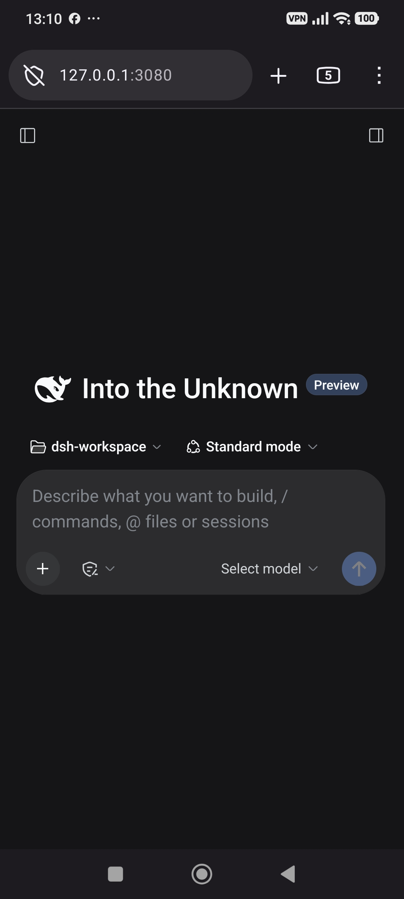
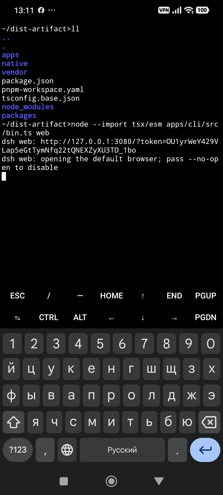

# dsh-builder

**[🇷🇺 Русский](README.md) | [🇬🇧 English](README.en.md) | [🇨🇳 中文](README.zh.md)**


Build [DSH (DeepSeek Harness)](https://github.com/deepseek-ai/deepseek-harness)
for **Android / Termux**, fully in **GitHub Actions**, without manual patches
on the phone. The artifact is reproducible: download -> unpack -> run.

> This is **not a fork of DSH**. The repository contains only patches (`patches/`)
> and build scripts (`scripts/`). DSH sources are checked out in CI from
> `deepseek-ai/deepseek-harness`.

**[🇷🇺 Русский](README.md) | [🇬🇧 English](README.en.md) | [🇨🇳 中文](README.zh.md)**

## 📖 Detailed Guide

If you are new to this project or want to understand the pipeline
(what is GitHub Actions, how to edit YAML, how to run and verify builds),
read **[GUIDE.md](GUIDE.md)**.

Quick cheat sheet:
*   `gh workflow run build-dsh.yml` — start a build.
*   `gh run watch` — watch progress.
*   `gh run download <ID>` — download the finished artifact.

---

### What is `workflow.yaml`?

This is `.github/workflows/build-dsh.yml`. It tells GitHub Actions:
*   **When** to run (`workflow_dispatch` — manually, `push` — on commit).
*   **What** to do (steps: Checkout, Install, Build, Patch, Package).
*   **Where** to put the result (artifact `dsh-android-arm64.tar.gz`).

### What is `git push`?

`git push` sends your local commits to GitHub. After that, GitHub Actions
can automatically start a build (if `on: push` is in the YAML).
If there is no auto-start — use `gh workflow run build-dsh.yml`.

## 📸 Screenshots

### DSH Web Interface


### DSH Startup in Termux


## Current Status

**Artifact `45725287927` is fully self-contained.** Download -> unpack -> run -> works.
No manual `cp`/`patch` required.

| Step | Status |
|---|---|
| `system.node` (NDK r27d, `bin/bionic/`) | ✅ ARM aarch64, Android 30 |
| `esbuild` (4 versions) | ✅ ARM aarch64 |
| `@rolldown/binding-android-arm64` (2 versions) | ✅ ARM aarch64 |
| `require_builtin.node` | ✅ ARM aarch64, product `require-builtin` |
| Patches 02 / 05 / 10 | ✅ in artifact |
| Patch 09 (attachment) | ⚠️ anchor drift (not a blocker for `web`) |
| `flock.js` bionic path | ✅ `patch_flock_path_android.py` |
| `session-persistence` rename | ✅ `patch_session_persistence.py` |
| **`web`** | ✅ starts, UI opens, key valid (2 models) |
| **`turn` (LLM)** | ✅ reaches API (`QUOTA` — only without balance) |

## Structure

```
dsh-builder/
├── .github/workflows/build-dsh.yml
├── patches/             # Android fixes for upstream (git apply)
├── scripts/             # local build scripts for Android
├── GOALS.md
├── RULES.md
├── RESURECT.md
└── GUIDE.md
```

## Pipeline `build-dsh.yml` (16 steps)

| # | Step | What it does |
|---|---|---|
| 1 | Checkout DSH Source | `deepseek-ai/deepseek-harness` |
| 2 | Checkout dsh-builder | `scripts/` + `patches/` -> `builder/` |
| 3 | Setup Node.js | 24 |
| 4 | Patch flock for Android | `patch_flock_ts.py` |
| 5 | Install Dependencies | `pnpm install --no-frozen-lockfile` |
| 6 | Install Android-native build tools | `install_android_build_tools.py` |
| 7 | Build DSH | `build:lib:host`, `build:lib:client`, `build:web`, `build:native-system` |
| 8 | Apply Android patches | `apply_patches.sh` — **after** `build:*` |
| 9 | Patch FiberState | `patch_fiberstate.py` |
| 10 | Patch flock.c | `patch_flock_c.py` (`flock` -> `fcntl`) |
| 11 | Patch flock.js path | `patch_flock_path_android.py` (android -> `bin/bionic/`) |
| 12 | Patch session-persistence | `patch_session_persistence.py` (`rename` to import) |
| 13 | Build system.node | NDK r27d -> ARM aarch64 |
| 14 | Build require_builtin.node | NDK cross-compile, `NARB_PRODUCT=require-builtin` |
| 15 | Package Artifact | `dsh-android-arm64.tar.gz` |
| 16 | Upload Artifact | `gh run download <id>` |

## Documents

- [GUIDE.md](GUIDE.md) — detailed step-by-step guide.
- [GOALS.md](GOALS.md) — 7 project goals.
- [RULES.md](RULES.md) — editing rules (#0–#555).
- [RESURECT.md](RESURECT.md) — state, how to continue from scratch.
