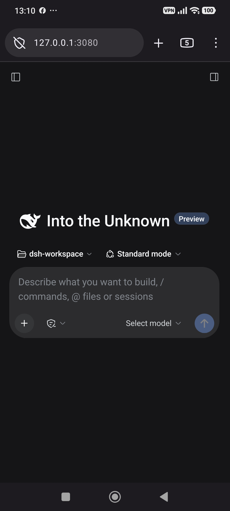
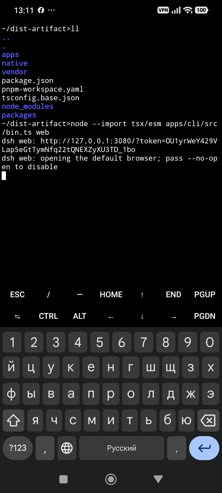

# dsh-builder

在 **Android / Termux** 上构建 [DSH (DeepSeek Harness)](https://github.com/deepseek-ai/deepseek-harness)，
完全在 **GitHub Actions** 中完成，无需在手机上手动打补丁。
构建产物可复现：下载 -> 解压 -> 运行。

> 这**不是 DSH 的分支**。本仓库只包含补丁 (`patches/`) 和构建脚本 (`scripts/`)。
> DSH 源代码在 CI 中从 `deepseek-ai/deepseek-harness` 检出。

**[🇷🇺 Русский](README.md) | [🇬🇧 English](README.en.md) | [🇨🇳 中文](README.zh.md)**

## 📖 详细指南

如果您是第一次接触这个项目，或者想了解构建流程
（什么是 GitHub Actions，如何编辑 YAML，如何运行和验证构建），
请阅读 **[GUIDE.md](GUIDE.md)**。

快速备忘：
*   `gh workflow run build-dsh.yml` — 启动构建。
*   `gh run watch` — 监控进度。
*   `gh run download <ID>` — 下载构建产物。

---

### 什么是 `workflow.yaml`？

这是 `.github/workflows/build-dsh.yml` 文件。它告诉 GitHub Actions：
*   **何时**运行 (`workflow_dispatch` — 手动，`push` — 提交时)。
*   **做什么** (步骤：Checkout, Install, Build, Patch, Package)。
*   **结果放在哪里** (构建产物 `dsh-android-arm64.tar.gz`)。

### 什么是 `git push`？

`git push` 将您本地的提交发送到 GitHub。之后，GitHub Actions
可以自动启动构建（如果 YAML 中有 `on: push`）。
如果没有自动启动 — 请使用 `gh workflow run build-dsh.yml`。

## 📸 截图

### DSH 网页界面


### 在 Termux 中启动 DSH


## 当前状态

**构建产物 `45725287927` 完全自包含。** 下载 -> 解压 -> 运行 -> 可用。
无需手动 `cp`/`patch`。

| 步骤 | 状态 |
|---|---|
| `system.node` (NDK r27d, `bin/bionic/`) | ✅ ARM aarch64, Android 30 |
| `esbuild` (4 个版本) | ✅ ARM aarch64 |
| `@rolldown/binding-android-arm64` (2 个版本) | ✅ ARM aarch64 |
| `require_builtin.node` | ✅ ARM aarch64, product `require-builtin` |
| 补丁 02 / 05 / 10 | ✅ 在产物中 |
| 补丁 09 (attachment) | ⚠️ anchor drift (不是 `web` 的阻塞问题) |
| `flock.js` bionic 路径 | ✅ `patch_flock_path_android.py` |
| `session-persistence` rename | ✅ `patch_session_persistence.py` |
| **`web`** | ✅ 启动，UI 打开，密钥有效（2 个模型） |
| **`turn` (LLM)** | ✅ 到达 API (`QUOTA` — 仅在没有余额时) |

## 结构

```
dsh-builder/
├── .github/workflows/build-dsh.yml
├── patches/             # 上游 Android 修复 (git apply)
├── scripts/             # Android 本地构建脚本
├── GOALS.md
├── RULES.md
├── RESURECT.md
└── GUIDE.md
```

## 流水线 `build-dsh.yml` (16 个步骤)

| # | 步骤 | 做什么 |
|---|---|---|
| 1 | Checkout DSH Source | `deepseek-ai/deepseek-harness` |
| 2 | Checkout dsh-builder | `scripts/` + `patches/` -> `builder/` |
| 3 | Setup Node.js | 24 |
| 4 | Patch flock for Android | `patch_flock_ts.py` |
| 5 | Install Dependencies | `pnpm install --no-frozen-lockfile` |
| 6 | Install Android-native build tools | `install_android_build_tools.py` |
| 7 | Build DSH | `build:lib:host`, `build:lib:client`, `build:web`, `build:native-system` |
| 8 | Apply Android patches | `apply_patches.sh` — **在** `build:*` **之后** |
| 9 | Patch FiberState | `patch_fiberstate.py` |
| 10 | Patch flock.c | `patch_flock_c.py` (`flock` -> `fcntl`) |
| 11 | Patch flock.js path | `patch_flock_path_android.py` (android -> `bin/bionic/`) |
| 12 | Patch session-persistence | `patch_session_persistence.py` (`rename` 到导入) |
| 13 | Build system.node | NDK r27d -> ARM aarch64 |
| 14 | Build require_builtin.node | NDK 交叉编译，`NARB_PRODUCT=require-builtin` |
| 15 | Package Artifact | `dsh-android-arm64.tar.gz` |
| 16 | Upload Artifact | `gh run download <id>` |

## 文档

- [GUIDE.md](GUIDE.md) — 详细分步指南。
- [GOALS.md](GOALS.md) — 7 个项目目标。
- [RULES.md](RULES.md) — 编辑规则 (#0–#555)。
- [RESURECT.md](RESURECT.md) — 状态，如何从头继续。
